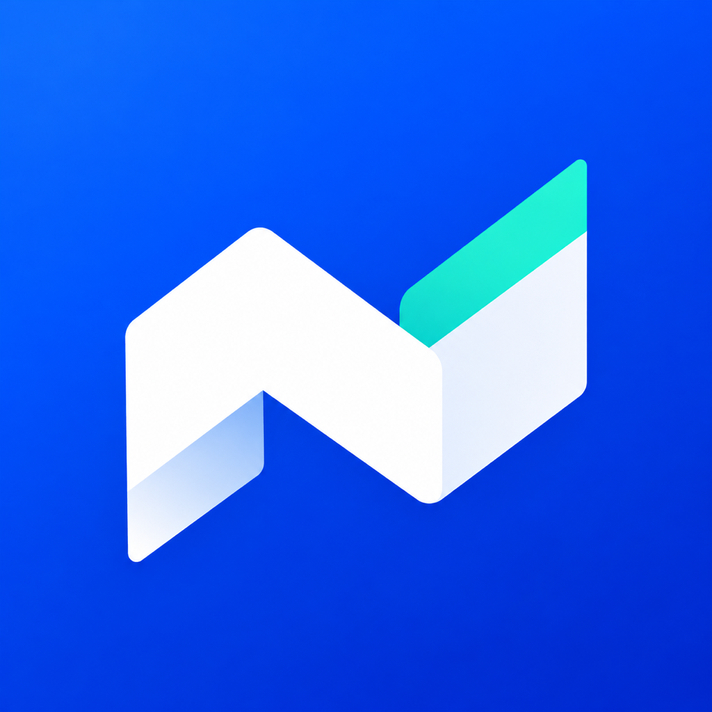
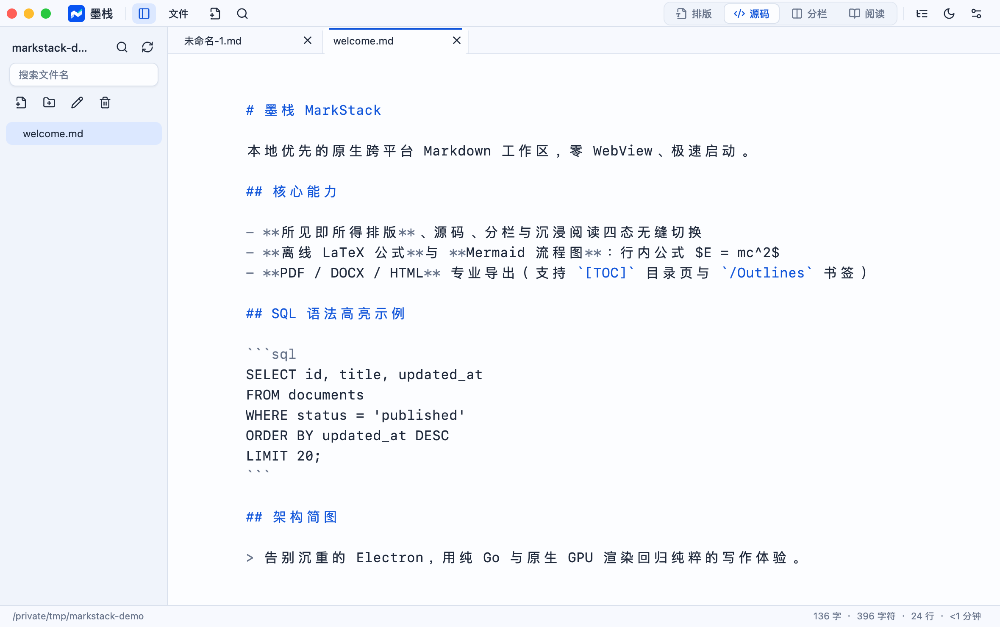
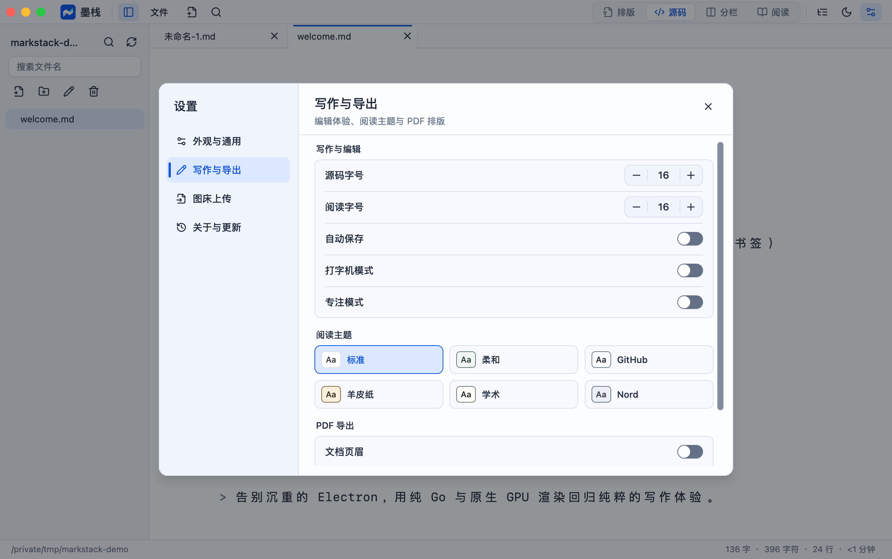
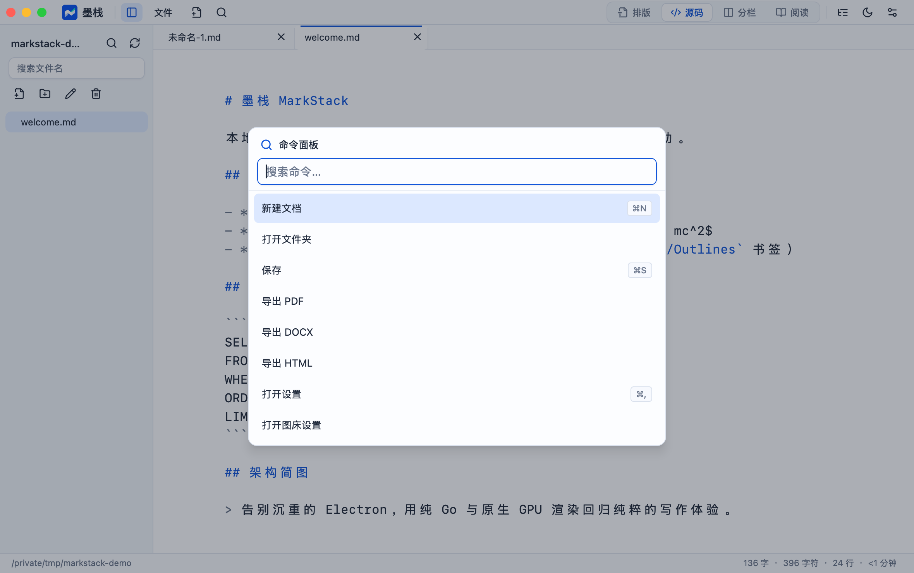

<div align="center">



# MarkStack (墨栈)

**A fast, local-first, cross-platform Markdown document workspace built with Go & Viva.**

English | [简体中文](README.zh-CN.md)

[](LICENSE)
[](https://go.dev/)
[](#build--package)
[](#highlights)

</div>

---

MarkStack (墨栈) is a native desktop Markdown workspace built in **Go 1.26** and **[Viva](https://github.com/vivaui/viva)**. No Electron, no WebView, no cloud lock-in — just crisp GPU-accelerated typography, offline math & diagram rendering, professional PDF/DOCX/HTML export, and fast local workspace management across **macOS, Windows, and Linux**.

## Screenshots

<p align="center">
  
</p>

<details open>
<summary><b>Modern Settings & Command Palette</b></summary>
<p align="center">
  
  
</p>
</details>

## Highlights

| Category | Capabilities |
| :--- | :--- |
| **Four-Mode Seamless Writing** | Switch effortlessly between WYSIWYG **Edit**, **Source**, **Split**, and distraction-free **Read** modes; supports Slash command menu (`/`), auto-trigger Markdown syntax, selection format bubble, typewriter & focus modes, and GFM table editing. |
| **Offline Math & Diagrams** | Pure-Go native **LaTeX math** (`$inline$` / `$$block$$`) and **Mermaid** (`flowchart`, `graph`, `sequenceDiagram`) vector rendering — zero WebView, works 100% offline. |
| **47+ Language Syntax Highlighting** | Powered by `chroma/v2` for both fenced Markdown code blocks (with language badge + one-click Copy) and standalone code files — including `SQL` (`mysql`, `postgresql`, `plsql`, `sqlite`), `Go`, `Java`, `Rust`, `C/C++`, `C#`, `Python`, `TypeScript`, `YAML`, `TOML`, `Dockerfile`, `Nginx`, `GraphQL`, `Protobuf`, `Diff`, `PowerShell`, and more. |
| **Professional PDF, DOCX & HTML Export** | Pure-Go **PDF** export with bundled Noto Sans SC font, running header/footer page numbers, 3 page layouts (`Standard` for everyday docs, `Compact` for dense notes, `Formal` with wider margins & generous spacing for reports/printing), clickable `[TOC]` table of contents, and `/Outlines` sidebar bookmarks; pure-Go **DOCX** export with native Word heading outlines & embedded images; offline self-contained **HTML** export. |
| **6 Curated Themes & Modern Settings** | Light & Dark modes paired with 6 reading themes (`Standard`, `Soft`, `GitHub`, `Parchment` warm paper, `Classic` high-contrast paper style for long-form reading, `Nord`), live theme swatches, bilingual UI (`简体中文` / `English`), and adjustable UI text scaling. |
| **Local Images & Optional Cloud Upload** | By default, pasted images are saved into your local `assets/` folder (with orphan image audit & Trash cleanup). If you publish articles online and want public image URLs instead of local files, configure **Settings → Image Upload** with your own HTTP upload endpoint or S3-compatible bucket (AWS S3 / Cloudflare R2 / MinIO / Aliyun OSS): pasted images upload automatically and insert their URL (with one-click fallback to local `assets/` if offline, and `0600` private credential storage). |
| **Workspace Intelligence & Safety** | Live word/character/reading-time stats, foldable Outline with search, workspace **Backlinks**, **Command Palette** (`Primary+Shift+P`), **Quick Open** (`Primary+P`), external disk change conflict banner, crash-safe recovery journal, and signed multi-base delta auto-updates. |

## Keyboard Shortcuts

> `Primary` is `⌘` (Command) on macOS and `Ctrl` on Windows / Linux.

| Action | Shortcut |
| :--- | :--- |
| Command Palette | `Primary + Shift + P` |
| Quick Open File / Tab | `Primary + P` |
| Settings | `Primary + ,` |
| Save / Save As | `Primary + S` / `Primary + Shift + S` |
| Switch Tab 1–9 | `Primary + 1..9` |
| Source / Split / Read Mode | `Primary + Alt + 1` / `2` / `3` |
| Filter Files / Workspace Search / Find in Doc | `Primary + F` / `Primary + Shift + F` / `Primary + Alt + F` |

## Installation & First Launch (Unsigned Builds)

Pre-built binaries are currently **unsigned** (no Apple Developer notarization or Windows Authenticode certificate yet):

- **macOS**: After dragging `MarkStack.app` into `/Applications`, if macOS reports *"MarkStack is damaged"* or *"cannot be verified"*, remove the quarantine attribute with one command and launch:
  ```sh
  xattr -dr com.apple.quarantine /Applications/MarkStack.app
  open /Applications/MarkStack.app
  ```
- **Windows**: If SmartScreen displays a warning, click **More info** → **Run anyway** (or unzip and run the portable `.zip` package).
- **Linux**: Install the `.deb` package with:
  ```sh
  sudo apt install ./markstack_*.deb
  ```

## Build & Package

Requires **Go 1.26+** and the platform prerequisites documented by Viva.

```sh
# Run from source
go run ./cmd/markstack
go run ./cmd/markstack ./examples

# Run tests
go test ./...

# Package macOS .app (unsigned local build)
bash scripts/package.sh --no-sign

# Package Linux .deb / Windows .exe & portable .zip
bash scripts/package-linux.sh --no-sign amd64
bash scripts/package-windows.sh --no-sign amd64
```

## License

MarkStack is licensed under the **[Apache License 2.0](LICENSE)**.

Third-party assets and dependencies remain subject to their respective licenses:
- **Noto Sans SC Regular** bundled for PDF export: [SIL Open Font License 1.1](internal/exportpdf/font/OFL.txt)
- **Lucide Icons**: [ISC License](assets/lucide/LICENSE)
- **Viva**, **Chroma**, **Goldmark**, **go-pdf/fpdf**, and other Go dependencies declared in `go.mod`
