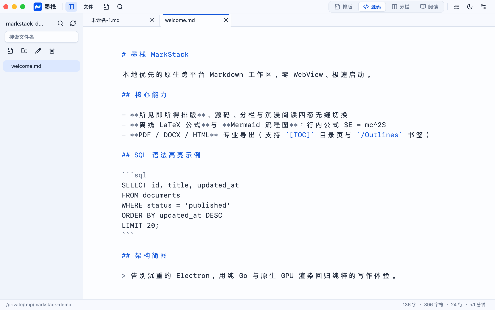
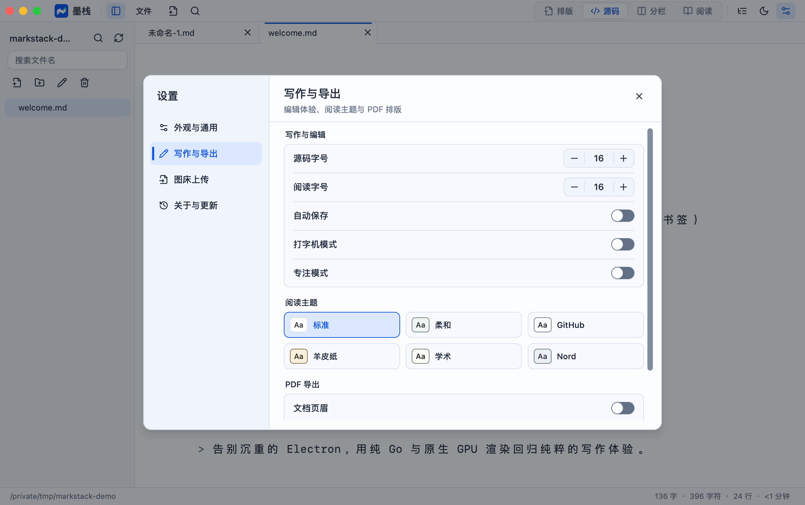
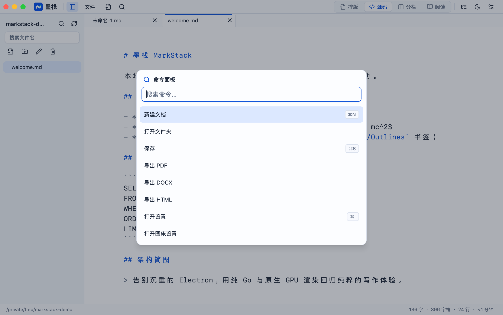

<div align="center">


# 墨栈 / MarkStack

**基于 Go 与 Viva 打造的极速、本地优先、跨平台 Typora 现代替代品。**

[English](README.md) | 简体中文

[](LICENSE)
[](https://go.dev/)
[](#构建与打包)
[](#核心亮点)

</div>

---

**墨栈（MarkStack）** 是一款使用 **Go 1.26** 与 **[Viva](https://github.com/vivaui/viva)** 原生构建的本地优先 Markdown 写作工作区。不依赖 Electron 或 WebView、无需账号与云端锁定，在 **macOS、Windows 和 Linux** 上提供原生 GPU 排版、离线公式与流程图渲染、专业 PDF/DOCX/HTML 导出以及极速本地知识库管理体验。

## 界面预览

<p align="center">
  
</p>

<details open>
<summary><b>现代设置页（6 套主题色样）& 全局命令面板</b></summary>
<p align="center">
  
  
</p>
</details>

## 核心亮点

| 模块 | 能力介绍 |
| :--- | :--- |
| **四态无缝写作体验** | 支持 **排版（所见即所得）/ 源码 / 分栏 / 沉浸阅读** 一键切换；内置 `/` 斜杠命令菜单、输入法安全自动触发语法、选区浮动格式条、打字机/专注模式与 GFM 表格快捷编辑。 |
| **纯 Go 离线公式与图表** | 原生离线渲染 **LaTeX 数学公式**（`$行内$` / `$$块级$$`）与 **Mermaid 流程图/时序图**（`flowchart` / `graph` / `sequenceDiagram`），零 WebView、100% 离线可用。 |
| **47+ 主流代码语法高亮** | 基于 `chroma/v2` 为 Markdown 围栏代码块（带顶部语言徽章与一键复制）及独立源码文件提供高亮，全面覆盖 `SQL`（`mysql`、`postgresql`、`plsql`、`sqlite`）、`Go`、`Java`、`Rust`、`C/C++`、`C#`、`Python`、`TypeScript`、`YAML`、`TOML`、`Dockerfile`、`Nginx`、`GraphQL`、`Protobuf`、`Diff`、`PowerShell` 等。 |
| **专业 PDF / DOCX / HTML 导出** | 纯 Go 导出 **PDF**（内置 Noto Sans SC 中文字体、页眉页脚页码、标准/紧凑/学术排版预设、正文可点击 `[TOC]` 目录页与阅读器 `/Outlines` 侧边书签）；纯 Go 导出 **DOCX**（保留 Word 原生六级标题大纲与内嵌本地图片）；离线自包含 **HTML** 导出。 |
| **6 套阅读主题与现代设置页** | 亮色/暗色双外观搭配 6 套精选阅读主题（`标准 / 柔和 / GitHub / 羊皮纸 / 学术 / Nord`），带直观色样卡片预览、中英双语界面与独立界面字号调节。 |
| **本地图片管理与图床上传** | 内置 `assets/` 孤立图片审计与回收站清理、多文档共享图片保护；可选配置 **自定义 HTTP 表单** 或 **S3 兼容图床（纯 Go SigV4，支持 S3 / R2 / MinIO / 阿里云 OSS）**，凭证以 `0600` 独立私有存储，上传失败可一键回退本地保存。 |
| **工作区智能与数据安全** | 实时字数/阅读时长统计、可折叠筛选大纲、工作区 **反向链接（Backlinks）**、全局 **命令面板（`Primary+Shift+P`）**、**快速切文件（`Primary+P`）**、外部磁盘变更冲突保护、崩溃恢复快照与 Ed25519 多基线签名增量更新。 |

## 常用快捷键

> `Primary` 在 macOS 为 `⌘`（Command），在 Windows / Linux 为 `Ctrl`。

| 功能 | 快捷键 |
| :--- | :--- |
| 全局命令面板 | `Primary + Shift + P` |
| 快速打开文件 / 切换标签 | `Primary + P` |
| 打开设置 | `Primary + ,` |
| 保存 / 另存为 | `Primary + S` / `Primary + Shift + S` |
| 快速切换第 1–9 个标签页 | `Primary + 1..9` |
| 源码 / 分栏 / 阅读模式 | `Primary + Alt + 1` / `2` / `3` |
| 筛选文件名 / 工作区全文搜 / 文内查找 | `Primary + F` / `Primary + Shift + F` / `Primary + Alt + F` |

## 构建与打包

需要 **Go 1.26+** 及 Viva 所需的平台基础环境。

```sh
# 从源码运行
go run ./cmd/markstack
go run ./cmd/markstack ./examples

# 运行测试
go test ./...

# 打包 macOS 本地应用（未签名）
bash scripts/package.sh --no-sign

# 打包 Linux .deb / Windows .exe 与便携 .zip
bash scripts/package-linux.sh --no-sign amd64
bash scripts/package-windows.sh --no-sign amd64
```

## 开源协议

墨栈（MarkStack）采用 **[Apache License 2.0](LICENSE)** 开源协议。

内置资源与第三方开源依赖均遵循各自许可协议：
- **Noto Sans SC Regular**（PDF 导出内置中文字体）：[SIL Open Font License 1.1](internal/exportpdf/font/OFL.txt)
- **Lucide Icons**：[ISC License](assets/lucide/LICENSE)
- **Viva**、**Chroma**、**Goldmark**、**go-pdf/fpdf** 及 `go.mod` 中声明的其他 Go 开源依赖
